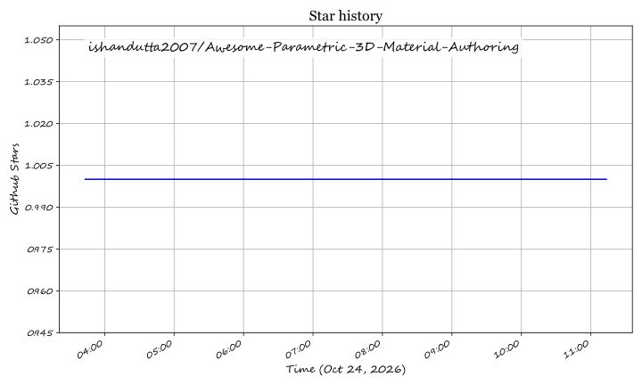

<div align="center">



# 🎨 Awesome Parametric 3D Material Authoring

**A curated ecosystem of commercial SaaS platforms, open-source software, node-based procedural graph editors, PBR texture synthesis engines, and real-time 3D texture painting suites.**

<p align="center">
  <a href="https://github.com/ishandutta2007/Awesome-Awesome-Awesome"></a><a href="https://discord.gg/jc4xtF58Ve"></a>
  <a href="https://github.com/ishandutta2007/Awesome-Parametric-3D-Material-Authoring/stargazers"></a>
  <a href="https://github.com/ishandutta2007/Awesome-Parametric-3D-Material-Authoring/network/members"></a>
  <a href="https://github.com/ishandutta2007/Awesome-Parametric-3D-Material-Authoring/blob/main/LICENSE"></a>
  <a href="https://github.com/ishandutta2007/Awesome-Parametric-3D-Material-Authoring/pulls"></a>
  <a href="https://github.com/ishandutta2007"></a>
</p>

</div>

---

## 📑 Table of Contents
- [📖 Overview & Key Concepts](#-overview--key-concepts)
- [📊 Sector Overview & Market Dynamics](#-sector-overview--market-dynamics)
- [🏢 Commercial & SaaS Platforms](#-commercial--saas-platforms)
- [💻 Open-Source Projects](#-open-source-projects)
- [🔄 Parametric Workflow Stack](#-parametric-workflow-stack)
- [🤝 How to Contribute](#-how-to-contribute)
- [⭐ Star History](#-star-history)
- [💖 Support](#-support)
- [⚖️ Disclaimer](#-disclaimer)

---

## 📖 Overview & Key Concepts

**Parametric 3D Material Authoring** represents modern procedural surface generation for 3D digital art, game development, and VFX pipelines. Instead of manually painting static bitmaps in 2D image editors, technical artists construct non-destructive **node-based graphs** that calculate mathematical noise functions, distance fields, and color mappings dynamically.

### 🔑 Key Pillars of Parametric Shading
- **Non-Destructive Workflows:** Alter resolution, color palettes, distress, or weathering at any phase simply by adjusting numeric parameters and seed integers without re-baking from scratch.
- **Physically Based Rendering (PBR) Compliance:** Export consistent material maps (Albedo/Base Color, Roughness, Metallic, Normal, Ambient Occlusion, Height, and Subsurface Scattering) across modern real-time engines.
- **Cross-Engine Portability:** Standardized material representation through open specifications such as **MaterialX** and **OpenPBR**, compatible with Unreal Engine 5, Unity, Godot Engine, and Blender.

---

## 📊 Sector Overview & Market Dynamics

The global 3D texturing, rendering, and parametric material authoring software market is estimated at **$1.8B to $2.4B**, growing at a **~12.5% CAGR** driven by AAA gaming, virtual production (VFX), architectural visualization, and real-time XR environments.

The sector demonstrates a **highly concentrated, winner-take-all structure at the top tier**, where Adobe's Substance 3D ecosystem (Designer and Painter) serves as the entrenched industry standard across studio pipelines and `.sbs` / `.sbsar` asset delivery. Concurrently, the indie, self-hosted, and game-development mid-tier exhibits **emerging fragmentation**, enabled by Epic Games (Quixel Mixer), nimble commercial challengers (InstaMat, Marmoset Toolbag), and rapidly advancing open-source solutions (Material Maker, ArmorPaint, Blender Shader Editor) offering perpetual licensing and subscription-free alternatives.

---

## 🏢 Commercial & SaaS Platforms

The table below catalogs prominent commercial and SaaS platforms for 3D material authoring and texture painting, sorted by **Company Valuation / Revenue** in descending order.

| Platform | Company & Valuation / Revenue | Pricing | Free Tier / Trial Limit | Key Capabilities & Pipeline Target |
| :--- | :--- | :--- | :--- | :--- |
| **[Adobe Substance 3D Designer](https://www.adobe.com/products/substance3d-designer.html)** | Adobe Inc.<br>*(Valuation: ~$220B Market Cap / $21.4B Annual Rev)* | **$19.99/mo** ($219.88/yr) for Texturing Plan;<br>or **$199.99 one-time** perpetual on Steam | **30-day free trial** with full feature access and 30 asset downloads; **100% free educational license** for verified students & educators | Industry-standard node-graph procedural generator. Compiles `.sbsar` dynamic assets with parametric exposure for game engines and DCC tools. |
| **[Adobe Substance 3D Painter](https://www.adobe.com/products/substance3d-painter.html)** | Adobe Inc.<br>*(Valuation: ~$220B Market Cap / $21.4B Annual Rev)* | **$19.99/mo** ($219.88/yr) for Texturing Plan;<br>or **$199.99 one-time** perpetual on Steam | **30-day free trial** with full access to smart materials, brushes, and masking; **100% free educational license** for educators and students | Industry-standard 3D mesh texture painter. Offers real-time viewport baking, physics particles, smart masks, and multi-channel PBR brush engines. |
| **[Quixel Mixer](https://quixel.com/mixer)** | Epic Games<br>*(Valuation: ~$22.5B / ~$5.6B Annual Rev)* | **100% Free** for Unreal Engine renders;<br>historical standalone commercial non-UE at $19/mo or 5% UE royalty terms | **Free forever** with full access to Mixer toolset and unlimited Megascans library textures for any content rendered inside Unreal Engine | Layer-based texture mixer combining scan data with procedural noise, sculpt brushes, and channel packing designed for Unreal Engine 5. |
| **[InstaMat](https://instamaterial.com/)** | Abstract Technologies<br>*(Valuation: ~$20M private)* | Paid tiers start at **€9.99/mo** (~$11/mo billed annually) or **€14.99/mo** for Freelancer;<br>**€39.99/mo** for Small Studio | **Free Pioneer License forever** for personal or commercial use by individuals and entities with under **$100,000 gross annual revenue** | Next-generation unified material authoring, mesh painting, canvas layering, and graph procedural nodes with Python and C++ SDK integration. |
| **[Marmoset Toolbag](https://marmoset.co/toolbag/)** | Marmoset LLC<br>*(Valuation: ~$10M private / ~$4M Annual Rev)* | Starts at **$15.99/mo** (individual monthly), **$189.00/yr** (individual annual), or **$359.00 one-time** perpetual license | **30-day fully functional evaluation trial** with zero watermarks, full baker functionality, and unrestricted texture exports | Real-time GPU texture baking suite, 3D texture painter, and look-dev presentation renderer popular with real-time character and prop artists. |

---

## 💻 Open-Source Projects

Top open-source projects for procedural material authoring, node-based shading, texture synthesis, and PBR painting, sorted by **GitHub Stars_Count** in descending order.

1. **[Blender Shader Editor](https://www.blender.org/)** [](https://github.com/blender/blender/stargazers)  
   *The industry-leading open-source 3D production suite with integrated visual node-based shading.*  
   - **Engine:** Cycles & EEVEE Next  
   - **Highlights:** Principled BSDF surface shading, procedural noise algorithms (Voronoi, Musgrave, Wave, Gradient), Math/ColorRamp combinators, geometry nodes integration, and full Python automation via `bpy.data.materials`.  
   - **License:** GPL-3.0  

2. **[Krita](https://krita.org/)** [](https://github.com/KDE/krita/stargazers)  
   *Professional free and open-source painting program tailored for concept artists and texture illustrators.*  
   - **Engine:** Qt / C++  
   - **Highlights:** Dedicated seamless tiling mode (`W` key shortcut for infinite wraparound canvas), procedural brush engines, color management (OCIO, HDR), and wrap-around pattern authoring for hand-crafted 3D textures.  
   - **License:** GPL-3.0  

3. **[Material Maker](https://www.materialmaker.org/)** [](https://github.com/RodZill4/material-maker/stargazers)  
   *The leading standalone open-source procedural material authoring and 3D texture painting suite.*  
   - **Engine:** Godot Engine (C++ & GLSL)  
   - **Highlights:** 200+ procedural node library, Controlled Variations system, Aperture wireless connector nodes, direct 3D mesh model painting, and one-click export templates for Unity, Unreal Engine 5, Godot, and glTF PBR.  
   - **License:** MIT  

4. **[ArmorPaint](https://armorpaint.org/)** [](https://github.com/armory3d/armorpaint/stargazers)  
   *Stand-alone, GPU-accelerated 3D PBR texture painting software designed from the ground up for speed.*  
   - **Engine:** Armory / Kha (Haxe & C)  
   - **Highlights:** Direct-on-mesh 4K/16K texture painting, node-based materials aligned with Cycles nodes, raytracing viewport preview (Direct3D12/Vulkan DXR), and multi-channel PBR map export.  
   - **License:** zlib / libpng  

5. **[pbrt-v4](https://pbrt.org/)** [](https://github.com/mmp/pbrt-v4/stargazers)  
   *The definitive open-source reference implementation of physically based rendering.*  
   - **Engine:** Modern C++20 / CUDA GPU & CPU  
   - **Highlights:** Accompanies the seminal Academy Award-winning textbook *Physically Based Rendering: From Theory to Implementation*, implementing state-of-the-art spectral rendering, microfacet BSDF models, hair/subsurface scattering, and Wavefront GPU ray tracing.  
   - **License:** Apache-2.0  

6. **[glslEditor](https://patriciogonzalezvivo.github.io/glslEditor/)** [](https://github.com/patriciogonzalezvivo/glslEditor/stargazers)  
   *Interactive WebGL and desktop fragment shader editor for rapid procedural pattern and texture design.*  
   - **Engine:** JavaScript / WebGL / C++  
   - **Highlights:** Real-time visual feedback, embedded color pickers, interactive curve and vector widgets, and instant GLSL code generation for procedural shaders.  
   - **License:** BSD-3-Clause  

7. **[MaterialX](https://materialx.org/)** [](https://github.com/AcademySoftwareFoundation/MaterialX/stargazers)  
   *The industry-standard open specification and library for transferring rich material and look-development data across digital content creation applications.*  
   - **Engine:** C++ & Python  
   - **Highlights:** Initiated by Lucasfilm and Industrial Light & Magic (ILM); supported across Maya, 3ds Max, Houdini, Unreal Engine, Blender, and WebGL viewers. Provides open node graphs, code generation backends (GLSL, OSL, MSL, Vulkan), and native USD/Hydra integration.  
   - **License:** Apache-2.0  

8. **[GIMP + Resynthesizer](https://github.com/bootchk/resynthesizer)** [](https://github.com/bootchk/resynthesizer/stargazers)  
   *Classic open-source texture synthesis and non-parametric patch generation plugin.*  
   - **Engine:** C  
   - **Highlights:** Example-based texture synthesis that generates seamless, tileable texture maps from photographic samples, removes unwanted surface artifacts, and synthesizes continuous natural materials.  
   - **License:** GPL-3.0  

9. **[Texture Synthesis](https://github.com/EmbarkStudios/texture-synthesis)** [](https://github.com/EmbarkStudios/texture-synthesis/stargazers)  
   *High-performance, example-based procedural texture synthesis library developed in Rust.*  
   - **Engine:** Rust (CLI & Library)  
   - **Highlights:** Developed by Embark Studios; generates high-resolution non-repeating surface textures from tiny input patches, featuring tiling generation, color transfer, and multi-channel inpainting.  
   - **License:** MIT / Apache-2.0  

10. **[OpenPBR](https://github.com/AcademySoftwareFoundation/OpenPBR)** [](https://github.com/AcademySoftwareFoundation/OpenPBR/stargazers)  
    *The next-generation open standard for physically based shading models, co-developed by Adobe and Lucasfilm.*  
    - **Engine:** MaterialX / Shading Specification  
    - **Highlights:** Successor to Autodesk Standard Surface and Adobe Standard Material under the Academy Software Foundation (ASWF). Unifies dielectric, metallic, transmission, retro-reflective, and thin-film wave interference models.  
    - **License:** Apache-2.0  

---

## 🔄 Parametric Workflow Stack

```
   ┌────────────────────────────────────────────────────────┐
   │ 1. Procedural Graph Design                             │
   │    • Material Maker (Node graph generation)            │
   │    • Adobe Substance 3D Designer (.sbs / .sbsar)       │
   │    • Blender Shader Editor (Procedural Math & Noise)   │
   └───────────────────────────┬────────────────────────────┘
                               │
                               ▼
   ┌────────────────────────────────────────────────────────┐
   │ 2. 3D Mesh Texture Painting & Baking                   │
   │    • ArmorPaint (GPU PBR Texture Painting)             │
   │    • Adobe Substance 3D Painter (Multi-layer smarts)   │
   │    • Marmoset Toolbag (High-speed baking & look-dev)   │
   └───────────────────────────┬────────────────────────────┘
                               │
                               ▼
   ┌────────────────────────────────────────────────────────┐
   │ 3. Standardization & Pipeline Export                   │
   │    • MaterialX / OpenPBR XML Graph Definitions         │
   │    • Packed PBR Bitmaps: Albedo, Roughness, Normal, AO │
   │    • Real-time Engines: Unreal Engine 5, Godot, Unity  │
   └────────────────────────────────────────────────────────┘
```

---

## 🤝 How to Contribute

Contributions from technical artists, shader developers, and 3D creators are welcome!

1. **Fork the Repository:** Click the fork button at the top right of this page.
2. **Add or Update Tools:** Follow the existing Markdown structure:
   - For **SaaS**: include company valuation/revenue, exact starting tier pricing, specific free trial/tier limits, and target workflow.
   - For **Open-Source**: include Stars_Count badge with `style=social&color=white` linking to the stargazers page, license, engine, and core capabilities.
3. **Submit a Pull Request:** Provide a clear summary of your changes.

---

## ⭐ Star History

[](https://star-history.dera.page/#ishandutta2007/Awesome-Parametric-3D-Material-Authoring&type=date&legend=top-left)

---

## 💖 Support

Thank you for exploring and bookmarking **Awesome-Parametric-3D-Material-Authoring**! 🌟

If this resource saves you time, enhances your 3D workflow, or introduces you to new creative tools, please consider supporting the project:
- ⭐ **Star this repository** to improve visibility across the 3D computer graphics community.
- 🍴 **Fork and share** with fellow technical artists, shader engineers, and game devs.
- ☕ **Sponsor or buy a coffee** to help maintain updates and new curation: [**Sponsor Dashboard**](https://github.com/sponsors/ishandutta2007)

---

## ⚖️ Disclaimer

- This is a community-maintained index for informational purposes. Product names, logos, and brands are property of their respective owners.
- Pricing, trial periods, and feature availability are subject to change by software vendors. Always refer to official vendor portals for binding terms.

## Star History

<a href="https://star-history.com/#ishandutta2007/Awesome-Parametric-3D-Material-Authoring&Timeline" align="center">
  <picture>
    <source media="(prefers-color-scheme: dark)" srcset="assets/ishandutta2007_Awesome-Parametric-3D-Material-Authoring_growth.svg">
    
  </picture>
</a>
